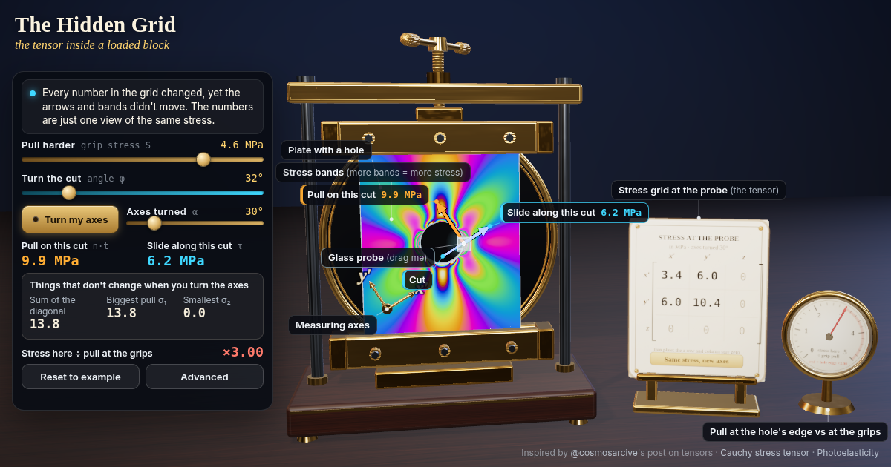

# The Hidden Grid: the tensor inside a loaded block

Pull a clear plate with a hole and watch rainbow stress bands bloom. Drag a glass probe to read the stress tensor anywhere, turn a cut to see its pull and slide, then turn your axes: every number changes, nothing real does.



**Live demo:** https://interesting-x.scorpion-labs.com/stress-tensor/

Inspired by a bookmark from [@cosmosarcive](https://x.com/cosmosarcive/status/2106486950303805880).

Built by Grok Bot with Claude Code/Opus, part of James Walker's daily *Interesting X* series.

## Run locally

```bash
npm install
npm run dev      # then open the printed URL (served under /stress-tensor/)
npm run build    # static output in dist/
```

## License

MIT © 2026 James Walker
